# Лабораторная работа №1
## Введение

Цель данной работы — познакомиться с технологией виртуальных машин и получить базовые навыки
администрирования Linux-системы. В качестве гипервизора используется VirtualBox, в качестве
гостевой операционной системы — Debian.

В задании дан следующий набор действий:

1. Установка виртуальной машины
   - Установите и настройте VirtualBox или VMware
   - Создайте новую виртуальную машину, выделив для неё 2-4 ГБ оперативной памяти и 30 ГБ жесткого диска
2. Установка Debian
   - Скачайте ISO-образ Debian и установите его на виртуальную машину
   - Настройте основные параметры: имя компьютера, язык, часовой пояс, пользователи и пароли
3. Обновление системы
   - Настройте подключение к интернету через NAT и Bridget
   - Выполните обновление системы, используя `apt-get update` и `apt-get upgrade`
4. Настройка SSh
   - Установите и настройте SSH-сервер
   - Настройте доступ по SSH с вашего основного компьютера к виртуальной машине (по паролю, по ключу ssh)

В результате должна получиться работающая виртуальная машина с Debian, доступная по SSH с основного компьютера двумя способами.

## 1. Установка виртуальной машины
### Шаг №1. Обновление системы
Обновляем Arch Linux командой. Модули VirtualBox собираются под конкретную версию ядра, поэтому она должна быть актуальной.

### Шаг №2. Установка VirtualBox через терминал.
Установка происходит через команду `sudo pacman -S virtualbox virtualbox-host-dkms linux-headers`, которая состоит из программы-гипервизора, модулей ядра и заголовочных фалов ядра. После этого перезагружаем компьютер.

### Шаг №3. Запуск VirtualBox.
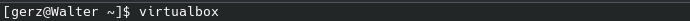

## 2. Установка Debian
### Шаг №1. Скачиваем ISO-образ
Установка файла `debian-13.7.0-amd64-netinst.iso` происходит с официального сайта.

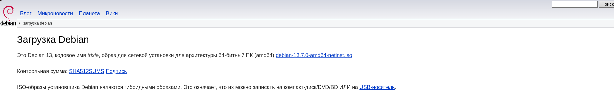

### Шаг №2. Создаём виртуальную машину в VirtualBox
Выбираем имя, настраиваем тип системы  Linux и подключаем скачанный образ.

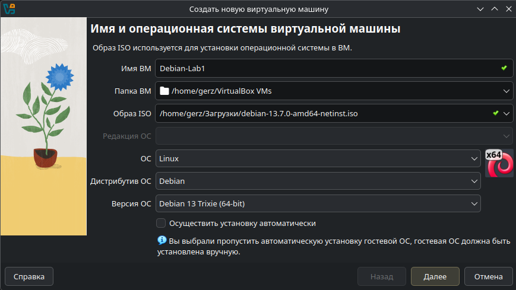

### Шаг №3. Выделяем память
Согласно условиям задания, выделяем 2048 МБ оперативной памяти и 30 ГБ виртуального диска в динамическом режиме.

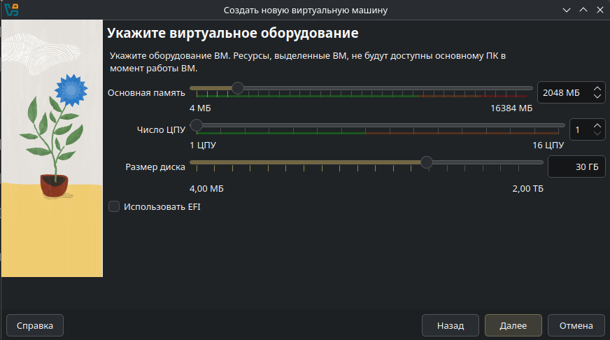

### Шаг №4.  Установка и настройка Debian
Запускаем машину и проходим установщик. Выбираем:

1. Графическая установка — Graphical install;

2. язык — русский;

3. расположение — Российская Федерация;

4. раскладка клавиатуры — русская, переключение Alt+Shift;

5. имя компьютера — debian-lab1;

6. доменное имя — пустое;

7. пароль root — пустое (в этом случае Debian блокирует учётную запись root и выдаёт обычному пользователю права sudo);

8. полное имя пользователя — Gerz;

9. имя учётной записи — gerz;

10. пароль пользователя — задаётся при установке;

11. часовой пояс — UTC+7;

12. разметка диска — «Авто — использовать весь диск», все файлы в одном разделе, изменения подтверждаем;

13. зеркало репозитория — deb.debian.org;

14. программное обеспечение — SSH server и стандартные системные утилиты;

15. загрузчик GRUB — устанавливаем на диск /dev/sda.

### Шаг №5. Вход в систему
После завершения установки в открывшейся консоли вводим логин, пароль и проверяем имя компьютера.

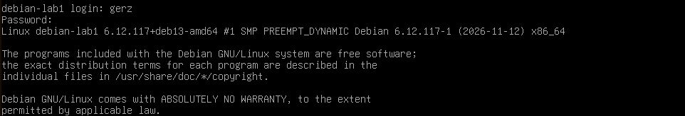

## 3. Обновление системы
### Шаг №1. Проверяем NAT и доступ в интернет.
Команда `ip a` показывает, что у NAT-интерфейса enp0s3 появился адрес.

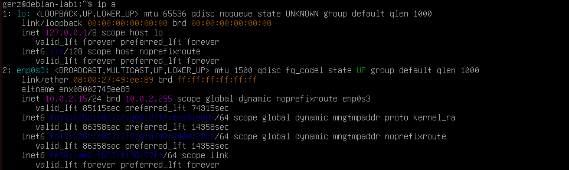

### Шаг №2. Добавляем Bridged-адаптер.
Выключаем виртуалку, в настройках VirtualBox в разделе «Сеть» включаем «Адаптер 2» с типом подключения «Сетевой мост» и снова запускаем машину.

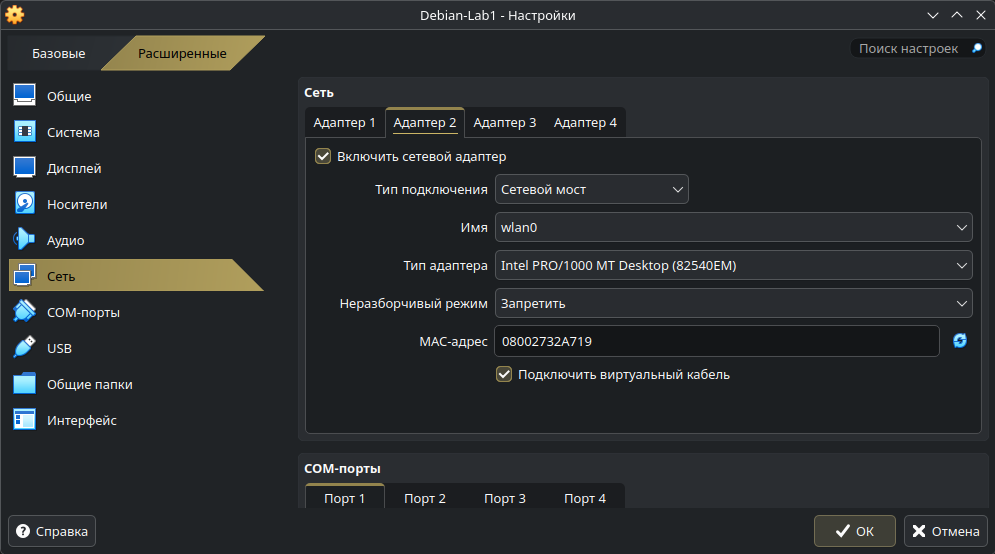

### Шаг №3. Настраиваем Bridged-интерфейс.
Команда `ip a` показывает, что у NAT-интерфейса enp0s3 появился адрес.

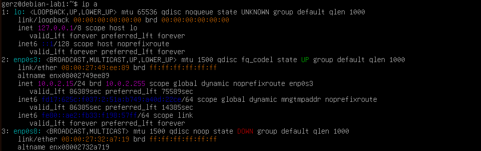

### Шаг №4. Добавляем Bridged-адаптер.
Интерфейс enp0s8 адрес по DHCP автоматически не получил. Поэтому устанавливаем DHCP-клиент и поднимаем интерфейс вручную командами:

`sudo apt update`

`sudo apt install isc-dhcp-client`

`sudo dhclient enp0s8`

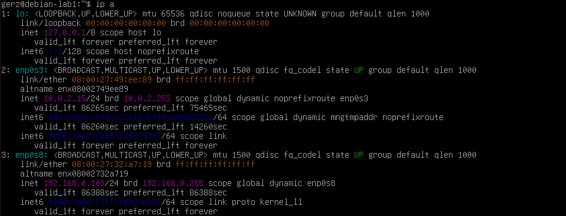

### Шаг №5.  Убеждаемся, что интернет работает нормально.
Повторяем `ip a` (у enp0s8 появился адрес вида 192.168.x.x) и `ping -c 4 8.8.8.8`.

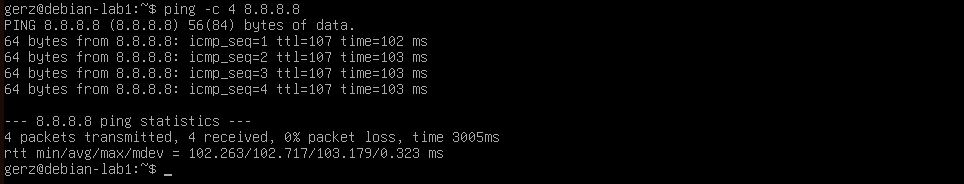

### Шаг №6. Обновляем систему
`sudo apt-get update` — обновляет локальный список доступных пакетов из репозиториев

`sudo apt-get upgrade` — устанавливает свежие версии всех установленных пакетов

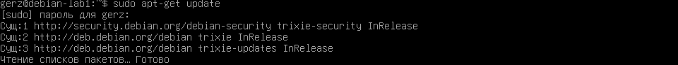
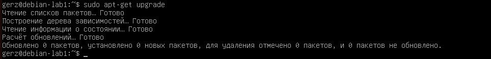

## 4. Настройка SSH
### Шаг №1. Проверяем SSH-сервер в виртуалке.
Команда `systemctl status ssh` показала состояние `active (running)` — сервер был установлен ещё на этапе установки Debian и запущен, он слушает порт 22.

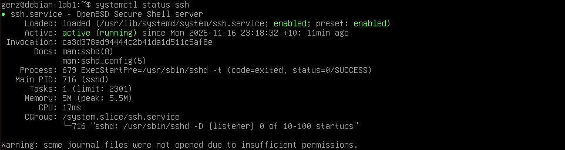

### Шаг №2. Настраиваем проброс портов.
Настраиваем проброс портов:

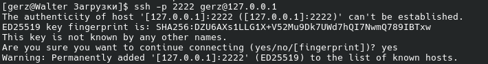

### Шаг №3. Подключаемся по паролю с основного компьютера:

При первом подключении SSH-клиент просит подтвердить отпечаток (fingerprint) сервера — отвечаем `yes`, он сохраняется в `~/.ssh/known_hosts`. Вводим пароль пользователя виртуалки и проверяем, что мы внутри: `hostname` возвращает `debian-lab1`. Выходим командой `exit`.

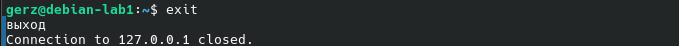

### Шаг №4. Генерируем ключи на основном компьютере
Проверяем их командами `ssh-keygen -t ed25519` и `ls ~/.ssh. В ~/.ssh` появиляются приватный ключ `id_ed25519` и публичный `id_ed25519.pub`.

### Шаг №5. Переносим публичный ключ в виртуальную машину.

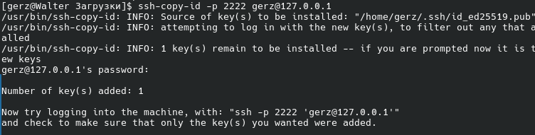

### Шаг №6. Входим по ключу:

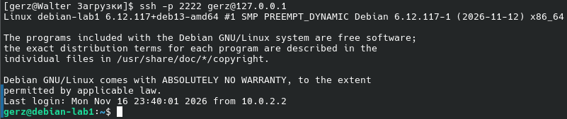

---

## Итоги

В ходе работы была развёрнута полноценная виртуальная среда: установлен и настроен VirtualBox, создана виртуальная машина с выделенными ресурсами и на неё установлена ОС Debian с базовыми параметрами. Система обновлена до актуального состояния через apt-get update и apt-get upgrade.

Настроено сетевое подключение в двух режимах: NAT обеспечил виртуальной машине доступ в интернет, Bridged-адаптер добавлен для связи с локальной сетью. Поскольку беспроводная точка доступа фильтрует виртуальные MAC-адреса, связь «хост → гость» организована через проброс портов NAT.

Настроен SSH-доступ с основного компьютера к виртуальной машине двумя способами: по паролю и по ключу (ed25519) с использованием утилиты ssh-copy-id. Доступ по ключу работает без ввода пароля и соответствует современной практике администрирования серверов.

