# Лабораторная работа №2
## Введение

Цель данной работы — освоить базовые и продвинутые навыки администрирования Linux-системы, научиться управлять пользователями, группами и правами доступа, а также автоматизировать рутинные задачи с помощью Bash-скриптов. Работа выполняется на виртуальной машине Debian, развёрнутой в рамках предыдущей лабораторной работы.

В задании дан следующий набор действий:
1. Создание пользователей и групп
  - Создать трёх новых пользователей: admin, user1, user2.
  - Создать две группы: developers и testers, и распределить по ним пользователей.
2. Настройка прав доступа
  - Создать каталоги /home/admin/data и /home/admin/logs.
  - Настроить права: только пользователь admin может редактировать файлы в data, а группа developers может читать и писать в logs.
3. Изучение команд для работы с пользователями
  - Изучить команды useradd, usermod, groupadd, passwd, chown, chmod.
  - Изменить пароль для пользователя user1.
  - Заблокировать учётную запись пользователя user2.
4. Мониторинг активности пользователей
  - Использовать команды who, w, last для мониторинга.
  - Объяснить смысл команд и привести примеры использования.
5. Автоматизация управления пользователями
  - Создать Bash-скрипт, который автоматически создаёт пользователей и группы из текстового файла с заранее заданными именами.

В результате должна получиться система с чётко разграниченными правами доступа, работающим механизмом мониторинга сессий и готовым инструментом для массового создания учётных записей.

## 1. Создание пользователей и групп
### Шаг №1. Создание пользователей
После открытия VirtualBox и входа в учётную запись создаём трёх пользователей по условию задания.

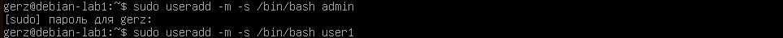

Так как для работы с пользователя им необходимы пароли, создадим их сейчас.

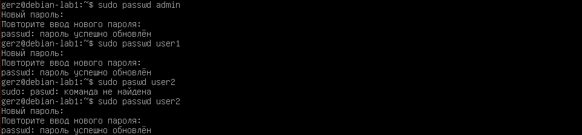

### Шаг №2. Создание групп

### Шаг №3. Добавление пользователей в группы
Разобьём пользователей по группам по такому порядку: admin — developers, user1 и user2 — testers.

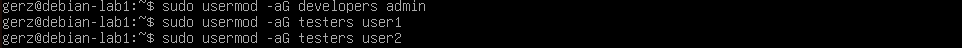

### Шаг №4. Проверка результата
Через id admin мы можем увидеть базовую информацию о выбранном пользователе. В конце будет его положение в конкретной группе. Таким образом проверяем каждого пользователя.

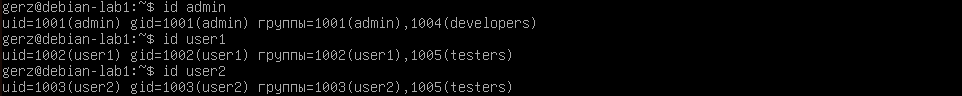

### Шаг №5. Проверка от лица пользователя
Также мы можем войти в учётную запись конкретного пользователя и узнать информацию, которая хранится в его папках

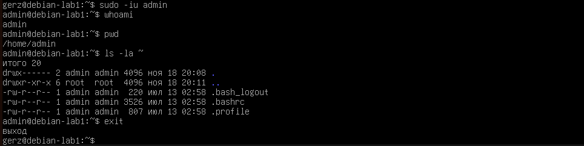

## 2. Установка Debian
### Шаг №1. Создание каталогов

### Шаг №2. Назначение владельцев
Поскольку в предыдущем шаге была допущена ошибка в написании команды, мы удаляем папку, создавшуюся там, где мы находились на тот момент. Создаём и назначаем ей владельца заново.

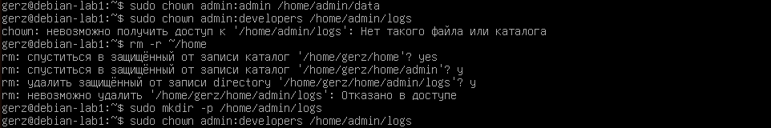

### Шаг №3. Выписывание прав
Согласно условиям задания, даём admin права на редактуру файлов data и ничего не выдаём остальным пользователям. В папке logs admin также получает полные права, developers — читать и писать, прочие не получают ничего.

### Шаг №4. Проверка
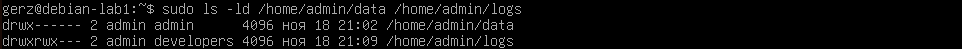

### Шаг №5. Проверка от лица пользователя
Переходим в учётные записи разных пользователей и проверяем их права и возможности.

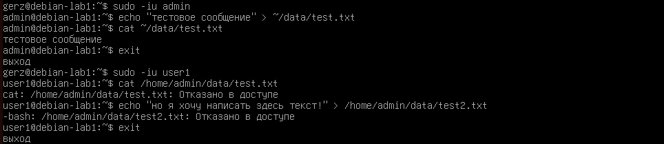

## 3. Изучение команд для работы с пользователями
### Шаг №1.  Смена пароля
Согласно заданию, мы меняем пароль пользователю user1.

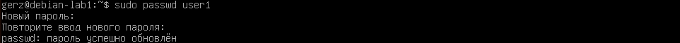

И проверяем результат:

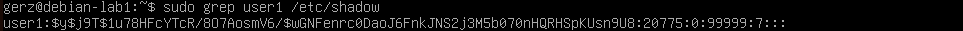

### Шаг №2. Блокировка учётной записи
Блокируем пользователя user2 и проверяем блокировку двумя способами: проверкой символов после sudo grep user2 /etc/shadow  и попыткой войти в учётную запись заблокированного пользователя.

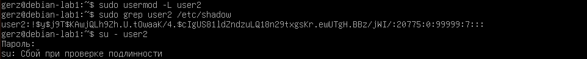

## 4. Мониторинг активности пользователей
### Шаг №1. who
Перед вводом команды входим в виртуалку с основного терминала и наблюдаем вывод:

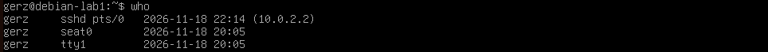

### Шаг №2. w
Эта команда показывает такой результат:

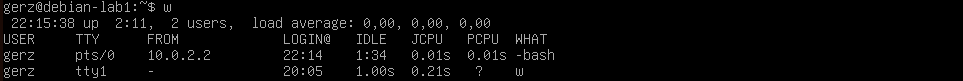

### Шаг №3. last
Здесь находится вся накопившаяся история.

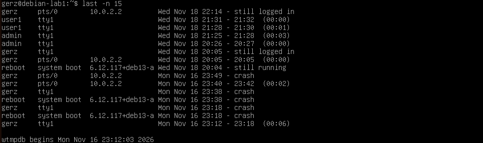

who — показывает, кто в системе сейчас: имя, терминал, время входа. Пример: who -u — с PID процессов; who -b — время последней загрузки.

w — то же, что who, плюс текущая активность каждого пользователя: какая команда выполняется, сколько времени бездействует, средняя загрузка системы. Пример: быстро оценить активность всех пользователей перед обслуживанием сервера.

last — история входов из журнала /var/log/wtmp: кто, когда, откуда и на сколько. Пример: last user1 — все входы конкретного пользователя; last reboot — история перезагрузок; sudo lastb — неудачные попытки входа, инструмент выявления подбора паролей

## 5. Автоматизация управления пользователями
### Шаг №1.  Файл со списком
Переходим в основной терминал и входим в виртуальную машину: shh -p 2222 gerz@127.0.0.1. Создаём и запускаем файл через  nano users.txt и заполняем его:

'# имя:группы:полное_имя
dev3:developers:Третий разработчик
dev4:developers,proectors:Четвёртый разработчик
test3:testers:Третий тестировщик
test4:testers,proectors:Четвёртый тестировщик

### Шаг №2. Скрипт
Здесь же создаём файл через команду nano create_users.sh и заполняем его кодом.

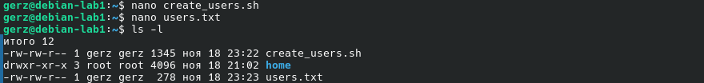

### Шаг №3.  Проверка
Проверяем существование файлов в терминале и в виртуалке. После этого активируем скрипт и проверяем его работу

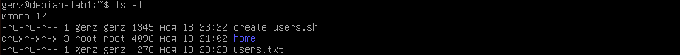
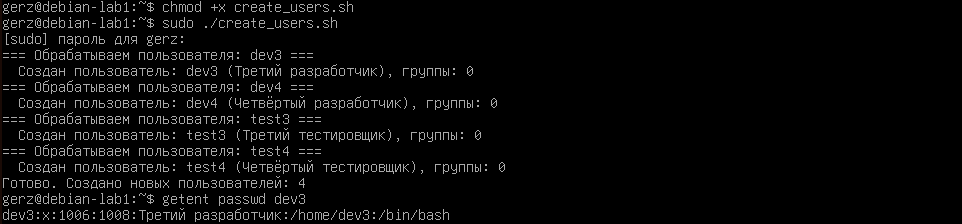

---

## Итоги

В ходе работы выполнено управление учётными записями на виртуальной машине Debian: созданы пользователи admin, user1, user2 и группы developers, testers, с распределением пользователей по ролям.

Настроены каталоги /home/admin/data (права 700, доступ только владельцу) и /home/admin/logs (права 770, доступ владельцу и группе developers). Проверка прав через chmod и ls -ld наглядно показала разграничение доступа: попытка просмотра из-под постороннего пользователя gerz ожидаемо завершилась отказом.

Освоены команды управления пользователями: изменён пароль user1 через passwd, заблокирована учётная запись user2 через usermod -L. Изучены утилиты мониторинга who, w, last.

Разработан Bash-скрипт create_users.sh для автоматизации создания пользователей и групп из файла users.txt. Отработаны навыки построчного чтения (while read), разбора строк (cut), работы с группами (tr) и точечного повышения прав (sudo). Скрипт протестирован на четырёх пользователях с временным паролем и проверен через getent passwd.
